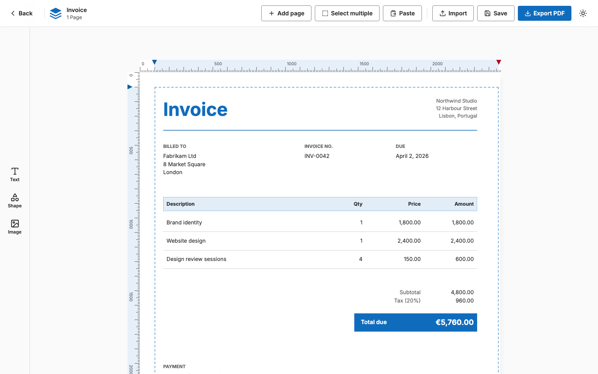
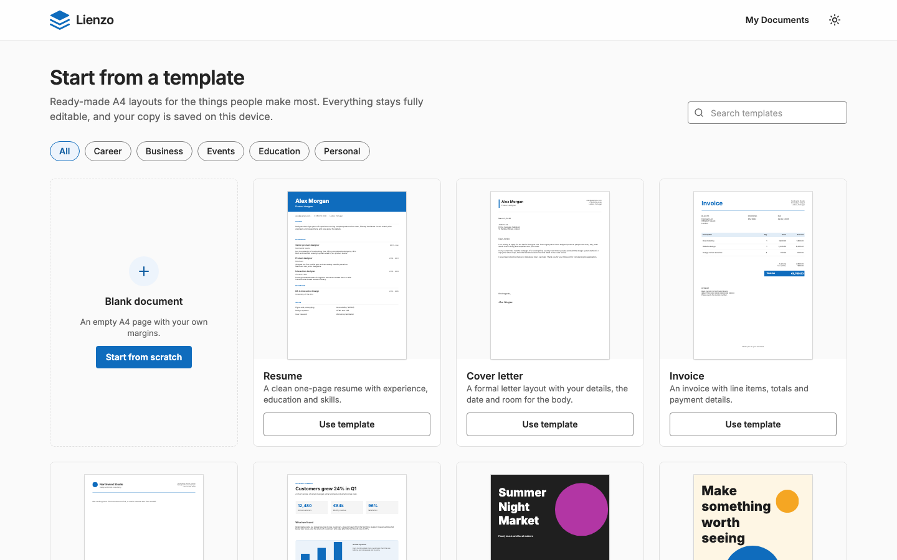

# Lienzo

A free document builder for A4 pages. Place text, shapes and images, start from a template, and export a PDF that keeps real, selectable text and carries your editable document inside it. No account, and nothing leaves your browser.

[](https://github.com/Deityhub/lienzo/actions/workflows/ci.yml)
[](LICENSE)

**Try it: <https://lienzo.deityhub.com>**

<picture>
  <source media="(prefers-color-scheme: dark)" srcset="docs/screenshots/editor-dark.png">
  
</picture>

## What you can do

- **Design on a canvas.** Add text, shapes (rectangles, circles, triangles, lines, arrows and more) and images, then move, resize, layer and style them. Rulers set the margins of each page, and elements stay inside them.
- **Start from a template.** 22 ready-made layouts: resumes, letters, invoices, flyers, certificates, menus, planners and more. Each is a normal document, so you can change anything.
- **Work with several elements.** Select many at once, group them, copy, cut, paste and duplicate (also between documents and tabs), and move them to another page. Pictures can be pasted straight in.
- **Never lose work.** Documents save automatically in your browser a moment after each change.
- **Export a real PDF.** Text stays text and shapes stay vector, with fonts embedded. The editable document is stored inside the PDF, so importing that PDF later brings your design back.
- **Back up and move.** Export one document or all of them as `.lienzo.json` files, and import them in another browser or on another device.
- **Light, dark or system theme,** and a layout that works on a phone. The page you design is always white, so a document looks the same in every theme.
- **14 font families,** loaded only when a document uses them.

<picture>
  <source media="(prefers-color-scheme: dark)" srcset="docs/screenshots/templates-dark.png">
  
</picture>

## Run it yourself

You need Node.js 22 (see `.nvmrc`) and Yarn 4 (`corepack enable` picks the pinned version).

```bash
git clone https://github.com/Deityhub/lienzo.git
cd lienzo
yarn install
yarn dev            # http://localhost:5173
```

| Command                 | What it does                                                |
| ----------------------- | ----------------------------------------------------------- |
| `yarn build`            | Production build (targets Vercel)                           |
| `yarn preview`          | Serve the production build                                  |
| `yarn lint`             | Prettier and ESLint checks                                  |
| `yarn format`           | Format the code                                             |
| `yarn check`            | Type check                                                  |
| `yarn test:unit:run`    | Unit and browser-component tests (Vitest)                   |
| `yarn test:e2e`         | End-to-end tests (Playwright; builds the app first)         |
| `yarn test`             | Both test suites                                            |
| `yarn brand:assets`     | Regenerate the favicons, app icons and social image         |
| `yarn docs:screenshots` | Retake the screenshots in this README                       |
| `yarn notices`          | Regenerate [THIRD_PARTY_NOTICES.md](THIRD_PARTY_NOTICES.md) |

### Docker

A multi-arch (amd64 and arm64) image is published to GitHub Container Registry and Docker Hub with every release.

```bash
docker run -p 3000:3000 -e ORIGIN=http://localhost:3000 ghcr.io/deityhub/lienzo:latest
```

The same image is on Docker Hub as `deityhub/lienzo`. Use a version tag instead of `latest` to pin a release, for example `ghcr.io/deityhub/lienzo:1.1.0`. To build it yourself, run `docker compose up --build` (<http://localhost:3000>).

| Variable | Default                  | Description                                                        |
| -------- | ------------------------ | ------------------------------------------------------------------ |
| `ORIGIN` | _(required for hosting)_ | Public URL the app is served from, e.g. `https://docs.example.com` |
| `PORT`   | `3000`                   | Port the server listens on                                         |
| `HOST`   | `0.0.0.0`                | Interface the server binds to                                      |

The image uses `adapter-node` (`ADAPTER=node`); the default build targets Vercel. Without Docker: `ADAPTER=node yarn build && node build`.

## Your documents and your data

Documents are stored only in your browser (IndexedDB). There is no server-side storage and no account, so export your documents to keep a backup or to move them. On the **Documents** page:

- **Export** on a card downloads that document as `<name>.lienzo.json`, and **Export all** downloads everything in one file.
- **Import** reads `.lienzo.json` files and PDFs exported from Lienzo. If a document with the same id already exists, you choose **Replace existing** or **Keep both**. Documents from older versions are upgraded automatically, and invalid ones are skipped and listed.
- In the editor, **Import** loads a single document as a new one, so saving never overwrites an existing document.

**About the PDF.** Every PDF exported from Lienzo has the editable document embedded as an attachment (`lienzo-document.json`), so the PDF you share is also a full backup. PDFs from other tools hold no such data and cannot be imported. Limits: characters outside Latin and Latin-extended show as `?`, images from sites that block downloads are left blank (you are told), image shadows are not drawn, and a PDF editor edits text line by line.

Images are kept inside the document when you paste a picture, and by address when you give a URL, in which case the address must stay reachable.

## Built with

[Svelte 5](https://svelte.dev/) and [SvelteKit](https://svelte.dev/docs/kit), TypeScript, [Tailwind CSS](https://tailwindcss.com/) 4, Vite, [pdf-lib](https://github.com/cantoo-scribe/pdf-lib) for the PDF, and [Lucide](https://lucide.dev/) icons. Tested with Vitest and Playwright. Deployed on Vercel, or as a Docker image. The visual design follows [Fluent 2](https://fluent2.microsoft.design/). Everything that ships with the app, with its license, is listed in [THIRD_PARTY_NOTICES.md](THIRD_PARTY_NOTICES.md).

```
src/lib/canvas      editing behaviour: dragging, resizing, selection, autosave, clipboard
src/lib/pdf         the PDF exporter
src/lib/stores      app state and the IndexedDB layer, with migrations
src/lib/templates   the template catalogue
src/lib/utils       pure helpers: geometry, file formats, sorting
src/routes          home, templates, documents and the editor
e2e                 end-to-end tests
```

## Contributing

Contributions are welcome. Please read [CONTRIBUTING.md](CONTRIBUTING.md) first (it covers setup, checks, commit titles and releases) and follow the [Code of Conduct](CODE_OF_CONDUCT.md). To report a security problem, see [SECURITY.md](SECURITY.md). Changes are listed in the [CHANGELOG](CHANGELOG.md).

## License

Lienzo is open source under the [GNU GPLv3](LICENSE). Third-party software and fonts keep their own licenses; see [THIRD_PARTY_NOTICES.md](THIRD_PARTY_NOTICES.md).

Made by [Chizoba Jude Ojini](https://judeojini.com).
